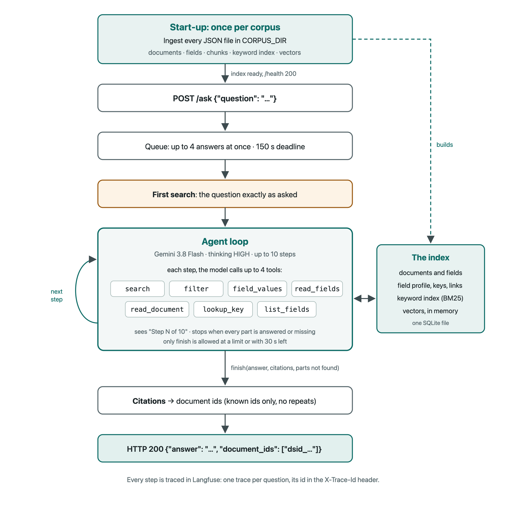

# CorpusQA

A question-answering agent over a company's records. It reads documents from Slack, Gmail,
Linear, Google Drive, HubSpot, Confluence, Fireflies, Jira and GitHub, and answers a question
with the records it relied on, each one checked against the index.



## What it does

- **Ingest.** Discovers, parses and cleans every record, learns each field's kind and values,
  chunks text at 512 tokens with field headers, and caches embeddings by content. Everything
  goes into one SQLite file.
- **Hybrid search.** BM25 keyword search (SQLite FTS5) and vector search, merged with rank
  fusion. Recall@10 is 0.727, against 0.696 for vectors alone and 0.603 for keywords alone.
- **Agent.** A ReAct loop on Gemini with 8 tools: hybrid search, field filters with exact
  counts, value lists, key lookups and document reads. Stopping rules and context compaction
  keep each question inside its step, tool and time budget.
- **Citations.** Every cited id is checked against the index before it is returned.
- **Serving.** FastAPI with `GET /health` and `POST /ask`, 4 questions at once under a deadline,
  traced end to end in Langfuse.
- **Evaluation.** A 79-question golden dataset split once into 30 tune and 49 held-out
  questions, scored on citations and judged fact by fact by an LLM judge. A hook stops coding
  agents from reading the held-out questions.

## Results (final run, all 79 questions)

| Metric | Result |
|---|---|
| Fully correct answers | 64 of 79 (81%) |
| Facts right | 290 of 308 |
| Citation precision / recall / F1 | 0.944 / 0.961 / 0.945 |
| No-answer questions that cite nothing | 10 of 11 |
| Errors and timeouts, 4 at a time | 0 |
| Latency p50 / p95 | 36.6 s / 55.3 s |
| Cost per question | $0.042 |

## Run it

You need [uv](https://docs.astral.sh/uv/) and a `GEMINI_API_KEY` in a `.env` file in the repo
root. The example runs on the development corpus in `data/corpus/`; any folder of JSON records
of the same format works.

```bash
set -a; . ./.env; set +a
CORPUS_DIR="$PWD/data/corpus" PORT=8080 ./serve
curl -s http://127.0.0.1:8080/ask -H 'Content-Type: application/json' \
  -d '{"question": "Which open tickets have the highest priority?"}'
```

[Data](#data) says where the corpus comes from. `uv run check` runs the tests and linters.

## Data

The development data describes Redwood Inference, a fictional company that sells LLM
inference as a service.

- **Corpus: [`data/corpus/`](data/corpus/).** 21,612 JSON documents from the nine sources
  above, fetched from [EnterpriseRAG-Bench](https://github.com/onyx-dot-app/EnterpriseRAG-Bench)
  (Onyx, 2026; [paper](https://arxiv.org/abs/2605.05253)). That public benchmark has about
  500,000 generated documents and 500 questions about the same company; this corpus is a subset
  of it, with some dataset-generation artifacts removed.
  [`data/uuid_index.json`](data/uuid_index.json) maps each document's `dataset_doc_uuid` (the
  id `/ask` cites) to its file. The benchmark is under the MIT license, copied in
  [`data/LICENSE`](data/LICENSE). The full benchmark can be downloaded from its
  [GitHub releases](https://github.com/onyx-dot-app/EnterpriseRAG-Bench/releases/latest) or
  from [Hugging Face](https://huggingface.co/datasets/onyx-dot-app/EnterpriseRAG-Bench).
- **Golden dataset (not included).** The 79 development questions, each with a reference
  answer and the ids of the documents the answer relies on, are not published here.
  [`eval/sets/`](eval/sets/) holds only their ids, split once into 30 tune and 49 held-out
  questions. To run the eval, put the file at `data/questions.jsonl`; git ignores that path.

## Read more

[`SOLUTION.md`](SOLUTION.md) explains the architecture, the choices that mattered, the full
evaluation and what is left to build.
