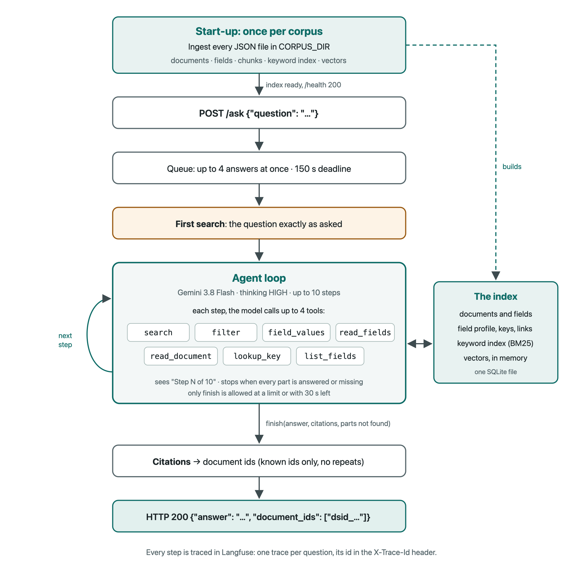

# SOLUTION — a question-answering service over a company's records

## How it works



Source: `docs/images/architecture.svg`.


This file says how to run the
service and the eval, the tradeoffs and the calls made, why the architecture is shaped the
way it is, what the eval says (the bad parts too), and what was left for later. It also
describes the AI development setup that produced the code.

Every number comes from a file in this repo. A link or a pointer in brackets says which one.

**Shipped setting:** `gemini-3.8-flash`, thinking level HIGH, `agent.md` v7. The final eval
results are in section 3.

---

## 1. What it is

`./serve` reads every JSON document under `CORPUS_DIR` at start-up. It builds one SQLite
index: documents, their metadata fields, what it learned about each field, text chunks with
a keyword index (FTS5), and an embedding per chunk. `/health` returns 200 once the index is
ready. `POST /ask` runs a tool-using agent (a ReAct loop on Gemini). Code first searches
the question exactly as asked. Then the model plans and calls deterministic tools: hybrid
search, field filters with exact counts, value lists, key lookups and document reads. When
it has the evidence, it calls `finish` with an answer and the records it cites. Code maps
those citations to `dataset_doc_uuid`s and checks every id against the index. Nothing in
the code knows this corpus's sources, fields or names: all of it is learned at ingest.

**At start-up (once per corpus)**

1. `./serve` installs the dependencies and starts the server. `/health` returns 503.
2. In the background, ingest reads every JSON file in `CORPUS_DIR`. A file it cannot use is
   set aside with the reason.
3. Each document and its fields go into one SQLite file. Ingest learns the corpus from them:
   each field's kind and common values, the range of believable dates, record keys and
   links.
4. Documents are split into chunks of about 512 tokens. Each chunk gets a short header
   (source, title, date, common field values) and goes into a keyword index.
5. Every chunk is embedded (cached vectors are reused) and the vectors are loaded into
   memory.
6. `/health` returns 200. A later start on the same corpus reuses the index.

**For each question (`POST /ask`)**

1. The request joins a queue: up to 4 answers run at once. Its 150-second deadline counts
   from arrival.
2. Code searches the question exactly as asked, and shows the results to the agent as its
   first search.
3. The agent (Gemini, thinking HIGH) works for up to 10 steps. In each step it can call up
   to 4 tools: `search`, `filter`, `field_values`, `read_fields`, `read_document`,
   `lookup_key`, `list_fields`. It sees how many steps it has left.
4. It ends by calling `finish` with the answer, the records it relies on, and the parts it
   could not find. If it runs out of steps or time, it is made to finish.
5. Code turns the cited records into document ids, keeps only ids that exist in the index,
   and replaces any internal record label left in the answer text with the record's name.
6. The reply is always HTTP 200 with the contract's body, `{"answer": "...", "document_ids": [...]}`;
   the trace id travels in the `X-Trace-Id` response header.

[`docs/knowledge/architecture/ingestion.md`, `http-server.md`; `src/corpusqa/agent/agent.py`
docstring]

---

## 2. How to run it

### 2.1 Run the service

**Requirements:** macOS or Linux, [uv](https://docs.astral.sh/uv/) (it installs Python
3.12), and a `.env` file in the repo root that holds `GEMINI_API_KEY` (it is not in git). Run every command
from the repo root.

Start the service as the grader does (`./serve` itself never reads `.env`, so the first line
loads the key into the shell):

```bash
set -a; . ./.env; set +a
CORPUS_DIR="$PWD/data/corpus" PORT=8080 ./serve
```

The first start installs the dependencies and builds the index in `.cache/`: about 6-7
minutes and about $6 of embeddings for `data/` (projected). Later starts on the same corpus
take about 2 seconds.

From a second shell:

```bash
# ready when this prints 200 (503 while the index is building)
curl -s -o /dev/null -w '%{http_code}\n' http://127.0.0.1:8080/health

# ask a question
curl -s http://127.0.0.1:8080/ask -H 'Content-Type: application/json' \
  -d '{"question": "Which open tickets have the highest priority, and who is assigned to them?"}'
# {"answer": "...", "document_ids": ["dsid_..."]}   (trace id in the X-Trace-Id header)
```

Stop it with Ctrl-C. Without a key it still starts, and every `/ask` returns the
internal-error answer. If `.env` also holds `LANGFUSE_*` keys, every request is traced.

### 2.2 Develop locally

```bash
curl -LsSf https://astral.sh/uv/install.sh | sh     # install uv, if it is not installed
uv run setup                                        # install dependencies (+ git hooks in a git repo)
uv run check                                        # every check; ends with "check: all steps passed"
uv run serve-dev                                    # the service on data/corpus, port 8080 (reads .env)
```

`uv run commands` lists every command. Not built yet: `uv run eval-baseline` (it exits
with a message).

### 2.3 How to run the eval

With `uv run serve-dev` running, from a second shell:

```bash
uv run eval-all --milestone final --concurrency 4
```

It sends all 79 dev questions (section 3) to `/ask` the way the grader does, 4 at a time with
the contract's 180 s limit each, then scores the cited documents and judges each answer. It is
done when it prints `summary: eval/results/all/ask/<time>/summary.md`.

### 2.4 Settings that matter

All in `src/corpusqa/config.py`.

| Setting | Value |
|---|---|
| `AGENT_MODEL` / `AGENT_THINKING_LEVEL` | `gemini-3.8-flash` / `"high"` |
| `AGENT_MAX_STEPS` | 10, then a forced `finish` |
| `AGENT_FIRST_SEARCH` | on: code searches the question before step 1 |
| `ASK_DEADLINE_S` / `ASK_MAX_CONCURRENT` | 150 s / 4 at once (the rest wait) |
| `EMBED_SPEND_CAP_USD` / `GEN_SPEND_CAP_USD` / `JUDGE_SPEND_CAP_USD` | $60 / $40 / $10 |

---

## 3. Evaluation

For more detail on every eval we ran (search-only, smoke, tune, earlier held-out runs, the
judge's calibration), see [docs/eval-log.md](docs/eval-log.md).

**The final run: all 79 dev questions** (30 tune, 49 held-out). The 49 held-out questions were
split off once at the start (fixed seed) and never read, debugged or tuned on, so they show how
the service does on questions it has not seen. The command (2.3) sends every question to `/ask`
the way the grader does, 4 at a time, then scores the citations as sets against the expected
ids and has an LLM judge check each answer against the question's facts.

Results of `uv run eval-all --milestone final --concurrency 4` (2026-10-17;
`eval/results/all/ask/20261017T123129Z/summary.md`):

| All 79 questions | Result |
|---|---|
| Answerable ids (68): precision / recall / F1 | 0.944 / 0.961 / 0.945 |
| Answerable ids: exact set | 56 of 68 (0.824) |
| One-record questions (31): precision / recall | 0.935 / 0.968 |
| Multi-record questions (37): all needed records cited | 33 of 37 (0.892) |
| No-answer questions that cite nothing | 10 of 11 |
| Answers correct / partly / wrong / not judged | 64 / 10 / 3 / 2 |
| Facts right / partly / missing / wrong (of 308) | 290 / 7 / 10 / 1 |
| Errors, timeouts (4 at a time) | 0 |
| Latency p50 / p95 / max | 36.6 s / 55.3 s / 59.3 s |
| Cost per question | $0.042 (plus $0.026 for judging) |

**What it does not cover**

- A different corpus: every run used `data/`; generality is checked only by unit tests on an
  invented corpus.
- The grader's load: a long queue of slow questions, a throttled key, network failures (unit
  tests only).
- Extra claims: the judge checks an answer against the gold answer and its facts, not against
  the records.
- A one-shot baseline: not built, so there is no margin to compare against.

**The results that are not flattering**

- It cites a little too much: precision 0.944 against recall 0.961, most on one-record
  questions (0.935 against 0.968). Each extra citation costs with the grader.
- It sometimes leaves a needed record out: 4 of 37 multi-record questions miss one.
- One of 11 no-answer questions cited a record, although its answer said the records lack it.
- 3 of 79 answers are wrong and 10 only partly correct; the judge could not judge 2.
- Thinking HIGH is slow: 36.6 s a question at the median (well under the 180 s limit).
- From earlier runs ([eval log](docs/eval-log.md)): no-answer questions cost the most (they use
  all 10 steps); the citing rule broke with thinking LOW (6 of 7 held-out no-answer questions);
  the model often writes `filter` argument names in quotes, which costs a step.
- Small samples, one run; the judge was calibrated against hand checks by Claude Code agents,
  not by a person.

---

## 4. Architecture, and the choices that mattered

The diagram at the top of this file shows how the parts below fit together.

- The code is one Python package, `src/corpusqa/`, in layers: `server -> agent -> retrieval -> store`, plus `ingest` (which uses only `store`), and `llm`, `obs` and `config` for every layer.
- About 14,000 lines of source and 14,400 lines of tests (930 tests).

### 4.1 Ingest at start-up into one SQLite file

**How it works**

- **Discover**: Walks `CORPUS_DIR` in a fixed order and skips hidden, non-JSON, unreadable or too-large files.
- **Parse**: Reads each file as JSON; sets aside bad JSON, files without `dataset_doc_uuid` and duplicate ids.
- **Core**: Picks each document's title and body text from its own fields.
- **Fields**: Stores every other key as a typed field row (text, number, date, list item).
- **Clean**: Tidies the body text (escaped line breaks, spaces, blank lines).
- **Store**: Writes documents and fields into the SQLite file in batches.
- **Dates**: Learns the range of believable years from the corpus and picks each document's created and updated dates.
- **Profile**: Learns each field's kind, how often it appears and its common values; finds record keys and links between records.
- **Chunk**: Splits each body into chunks of about 512 tokens, each with a header (source, title, date, common field values), and builds the keyword index.
- **Finalize**: Checks the database and publishes it.
- **Embed**: Embeds every chunk (cached vectors first) and loads the vectors into memory.

**Decisions, and why they mattered**

- **Every rule is learned from the loaded corpus; nothing names a source, field or value from `data/`** (`tests/unit/test_no_hardcoding.py` enforces it). The grader uses a different corpus, so anything hard-coded would break there.
- **Code decides only what is exact (ids, dates, splitting, counting); what a field means is left to the agent.** A first version that guessed field meanings at ingest was often wrong and could not be corrected at question time; the model reads a field in context.
- **A bad file is set aside with its reason; the build never stops for one file.** One broken file in an unseen corpus must not keep the whole service from starting.
- **One SQLite file holds documents, fields, the keyword index and the vectors.** The grader's machine runs only `./serve`, so there is no other service to install or start; searching 68,000 vectors in memory takes milliseconds.
- **The index is cached by a fingerprint of the corpus and the code.** A restart is ready in about 2 seconds, and any change to the corpus or the code rebuilds it by itself.
- **Each date is judged on its own against the learned range.** Generated timestamps are often fake (chat timestamps run up to the year 2286 on `data/`); this keeps the good dates without throwing away whole sources.

Details: `docs/knowledge/architecture/ingestion.md`.

### 4.2 Chunks and embeddings

**How it works**

- **Split**: Recursive split at about 512 tokens (whole document if it fits, else section, paragraph, line, sentence), no overlap.
- **Header**: Each chunk starts with source, title, date and the source's common field values (up to 400 characters).
- **Embed**: `gemini-embedding-2` at 768 dimensions, with separate prefixes for questions and documents.
- **Cache**: Each vector is stored by a hash of the model, settings and exact text, so a rebuild pays only for new text.

**Decisions, and why they mattered**

- **Recursive 512, chosen by a search-only eval of seven chunking variants.** Chunking decides what search can find at all; the eval needs no answer model, so it was cheap, and it picked the cheapest of the best.
- **Field values in every chunk header.** A document's status, owner or team then sits next to its text, so "the P1 ticket about X" can match; per-question recall at 10 rose from 0.673 to 0.727 and MRR from 0.588 to 0.671.
- **The embedding pass is time-boxed and capped by spend; a failed pass never stops start-up.** Start-up has a 4-hour limit and the key has a spend limit; chunks without a vector stay findable by keyword.

### 4.3 Hybrid search

**How it works**

- **Keyword**: BM25 over chunk header and text: the best 50 chunks in scope.
- **Meaning**: Cosine similarity over the vectors: the best 50 chunks in scope.
- **Fuse**: Reciprocal rank fusion (k = 60, equal weights), then chunks grouped into documents.
- **Scope**: Optional: one source, a created-date range, or the documents of a filter result.
- **Pages**: 8 documents a page; later pages rank deeper, so paging never runs out early.

**Decisions, and why they mattered**

- **Both rankers, fused.** Keyword search finds exact names and keys, meaning search finds reworded questions; together they found the most (recall at 10: 0.727, against 0.696 for meaning and 0.603 for keyword alone).
- **Equal weights and k = 60.** A weight grid found nothing clearly better, and the standard setting avoids tuning to 30 questions.
- **Quoted text and key-shaped tokens (`XY-123`) match as exact phrases.** A search can now say "no document contains this"; with loose matching every search returned near misses and the agent kept searching.

### 4.4 The tools

**What each tool returns**

- `search`: documents whose text is about the query, best first, 8 a page, 2 short passages each
- `filter`: every document of one source whose fields meet the conditions, with the exact count, 50 rows a page, and an `R#` handle for the whole set
- `field_values`: the real values of one field and how many documents hold each
- `read_fields`: chosen fields of many documents at once
- `read_document`: one whole document: every field and the full text
- `lookup_key`: the document that owns an identifier, and every document that refers to it
- `list_fields`: every field of one source, with kind, count and top values
- `finish`: ends the run: the answer, the cited records and the parts not found

**Decisions, and why they mattered**

- **Where a value lives decides the tool:** text is found by `search`; a field (a status, an owner, an amount) by `filter`, `field_values` and `read_fields`. Search returns the best few matches, so it cannot count or list everything; "which or how many X where field = Y" questions were most of the big misses before the filter existed.
- **Nothing is silently dropped: results are never cut, every list pages with the next offset and an exact total when one is known.** A cut list could hide exactly the row the answer needs, and the model would not know.
- **A value that matches nothing, or several spellings, gets an error that lists the real values; spellings are never merged silently.** A silent guess gives a confident wrong count; the list lets the model choose.
- **Short handles (`D1`, or `R1` for a whole result set) for one request only.** The model cites a 14-document result with one `R1` instead of retyping 14 long ids, and cannot mistype an id.
- **A catalog of each source's common fields in the system prompt.** The model knows which fields exist before its first `filter`, without spending a step.

### 4.5 The agent loop

**How it works**

- **Prompt**: Always system, question, then the history; each prompt only adds to the last, so Gemini's prompt cache keeps working.
- **First search**: Before step 1, code searches the question exactly as asked; it does not use a step.
- **Steps**: Up to 10; up to 4 tool calls per step, run at the same time; the model sees "Step N of 10".
- **Stop rule**: Finish once every part of the question is answered from a record read, or shown to be missing.
- **Forced finish**: After 10 steps, 25 tool calls, a failed model call or with 30 s left, only `finish` is allowed.
- **Compaction**: Above 80,000 tokens, older steps become one summary; the last step stays word for word.
- **Thinking**: Thinking level HIGH on every step.

**Decisions, and why they mattered**

- **One hand-written loop instead of a framework.** The deadline, the forced finish and the history are under exact control, every message is traced, and the prompt cache stays intact, which keeps cost down.
- **Each part was added for a measured problem, and kept only if the scores did not drop:**
  - **stop rule and step count:** the agent kept searching after it had everything; forced finishes went from 3 to 0 on smoke, cost -31%;
  - **exact search:** searches could never come back empty; now they can, cost -7%;
  - **thinking HIGH:** the model did not think on the long runs; with HIGH it gave the best answers (28 of 30 tune questions correct) and kept the citing rule best, at a higher cost;
  - **the citing rule:** unanswerable questions cited a background record; now they cite nothing (4 of 4 tune, 7 of 7 held-out);
  - **the first search and the search rules:** the model searched in the question's words and missed a record the plain question finds first; that false "not found" is fixed, and cost per question fell 33%.

### 4.6 Citations

**How it works**

- **Handles**: `finish` cites `D#` (one document) or `R#` (every document of a result set).
- **Resolve**: Code turns the handles into `dataset_doc_uuid`s.
- **Check**: The server keeps only ids that exist in the index, removes repeats, and keeps at most 500 (a cut is logged).
- **Clean the text**: Any handle left in the answer text is replaced by the record's title, source and date.

**Decisions, and why they mattered**

- **Cite a record only if it states something the question asks for; a "not found" answer cites nothing.** The grader scores citations: an extra document costs, and an unanswerable question is right only with no citation.
- **Only ids that exist in the index, at most 500.** A wrong or made-up id counts as an irrelevant citation, and the cap keeps the response under the contract's 1 MiB limit.
- **The citing rule is in the prompt only; no code checks it.** With thinking HIGH it held on all 11 unanswerable questions; with LOW it did not, so a code check is listed as future work (section 7).

### 4.7 Concurrency and the deadline

**How it works**

- **Process**: One server process.
- **Queue**: Up to 4 answers at once; the rest wait in line and are never refused.
- **Deadline**: 150 s from arrival, waiting included; the agent stops 10 s earlier.
- **Isolation**: Each request gets its own tool session, handles and agent; nothing is shared between requests.
- **Threads**: Database reads, embeddings and tools run off the server's event loop.

**Decisions, and why they mattered**

- **4 at once instead of one at a time.** The grader sends up to 4 and counts the wait in its 180 s; one at a time, the fourth would wait about 112 s before it started.
- **The deadline counts from arrival, and the agent stops 10 s before it.** Every answer arrives inside the grader's 180 s, even after waiting in the queue.
- **Nothing is shared between requests.** One question can never leak handles or history into another.

### 4.8 Tracing

**How it works**

- **Each `/ask`**: one Langfuse trace; its id is in the `X-Trace-Id` response header
- **Each model or embedding call**: the exact input, the output, tokens, cost and prompt version
- **Each tool call**: the arguments as given and as checked, and the exact text the model saw
- **Start-up**: one span per ingest step

**Decisions, and why they mattered**

- **Everything that runs is traced.** Every eval finding in this file (which search found which record, when the model thought, what each step cost) was read from these traces.
- **One package (`src/corpusqa/obs/`) talks to Langfuse, and secrets are removed from every value.** There is one place to change, and no key can leak into a trace.
- **Without keys (the grader's case) tracing is off and makes no network calls; a tracing error never breaks a request.** Tracing must cost nothing when nobody reads it.

### 4.9 Import boundaries

**The rules**

- Imports go down the layers only: server -> agent -> retrieval -> store
- `ingest` uses only `store`
- SQL only in `store/`
- The Gemini SDK only in `llm/`
- Langfuse and OpenTelemetry only in `obs/`

All of them are checked by `lint-imports` on every commit.

**Decisions, and why they mattered**

- **Every other layer uses interfaces with no SDK inside.** Unit tests run with fake models and no network, and changing a provider touches one package.

### 4.10 Built for a moving target

**How it works**

- **Index cache**: It already detects a changed corpus (file path, size, modification time).
- **Embedding cache**: A rebuild pays only for new or changed text (about a minute for `data/` with cached vectors).
- **One swap**: The server holds the index and the answerer behind one reference, replaced in one step.
- **Stable ids**: `dataset_doc_uuid` is the key everywhere, with a content hash per document.

**Decisions, and why they mattered**

- **Live ingestion itself is not built (section 7).** The grader runs one fixed corpus, and the parts above keep it a small change for later.

---

## 5. Tradeoffs and calls made

Each call: what was chosen, over what, and why. The full evidence is behind each link.

**The agent**

- **Chose our own ReAct loop with exact tools, over one-shot RAG or a framework agent.** "List all", "how many" and multi-hop questions need several lookups and exact counts, and our own loop keeps every message traced and the prompt cache intact. On tune, list questions came back exact (9 of 9 and 14 of 14 ids). No one-shot baseline was built. Evidence: [eval log, T4-T5](docs/eval-log.md), [agent decisions](docs/knowledge/decisions/agent.md).
- **Chose thinking HIGH, over LOW or off.** It gave the best answers and abstains on tune: 28 of 30 correct and 4 of 4 abstains at $0.039 a question, against LOW's 25 of 30 and 2 of 4 at $0.023 (3x faster). It was picked on tune before any held-out run, and held-out agreed (LOW abstained on only 1 of 7). Evidence: [eval log, T1-T5 and held-out milestones](docs/eval-log.md).
- **Chose code to run the first search, over telling the model to search the question first.** The model did not follow advice about its query wording (16 of 25 searches on one question used OR, against the tool text); code does it every time, in 0.53 s on average. Evidence: [prompt log, agent.md v7](docs/prompt-log.md), [eval log, T4-T5](docs/eval-log.md).
- **Chose to keep 10 steps, over raising the limit.** The long runs had all their records by step 3; more steps only cost more. Evidence: [eval log, run 1](docs/eval-log.md).
- **Chose to keep the whole history when compaction fails, over a short memory written by code** (the user's rule). A short memory drops facts, and the model can still read the whole history. It never triggered in an eval. Evidence: [agent decisions](docs/knowledge/decisions/agent.md).

**Search and tools**

- **Chose exact phrases for quoted text and keys, over loose word matching.** A key that exists nowhere must come back empty; loose matching always returned near misses, so the agent kept searching. Evidence: [eval log, run 3](docs/eval-log.md).
- **Chose pages with a next offset and no cut, over cutting long results or capping them** (the user's rule). The model must never lose data without being told. No forced finish or compaction came from a long result in any eval. Evidence: [retrieval decisions](docs/knowledge/decisions/retrieval.md).
- **Chose recursive 512-token chunks with field values in the header, over six other chunking variants.** It had the best recall and was the cheapest of the ties; the header fields added 0.054 recall at 10. Evidence: [chunking decisions](docs/knowledge/decisions/chunking.md).
- **Chose equal fusion weights and k = 60, over a tuned setting.** No setting in the grid beat it by more than noise (k = 20 is still open). Evidence: [retrieval decisions](docs/knowledge/decisions/retrieval.md).
- **Chose `gemini-embedding-2` at 768 dimensions, over `gemini-embedding-001` or a local model.** It reads 8,192 tokens per text; a local model adds a download to start-up and is likely weaker. 768 against 1,536 dimensions was not compared. Evidence: [embedding decisions](docs/knowledge/decisions/embeddings.md).

**The data**

- **Chose to judge each date on its own, over distrusting whole fields** (the user's rule). Distrusting whole fields left 11,596 of 11,606 chat threads with no usable date. The cost: a chat thread's own date often differs from the dates in its text (53% by more than 180 days), a trap for date filters. Evidence: [date decisions](docs/knowledge/decisions/dates.md).

**Answers and serving**

- **Chose a citing rule in the prompt, over a code check.** The rule is free; a code check of "is this record relevant" needs another model call. A small code net still replaces handles left in the answer text. The rule held with HIGH on tune (4 of 4), not with LOW on held-out (1 of 7). Evidence: [prompt log, agent.md v5](docs/prompt-log.md), [eval log](docs/eval-log.md).
- **Chose 4 answers at once with a queue, over one at a time.** One at a time would push the fourth answer close to the contract's 180 s. On held-out with HIGH and 4 at once, the slowest answer took 72.1 s. Evidence: [server decisions](docs/knowledge/decisions/server.md).

**Evaluation and tracing**

- **Chose a stronger model to judge answers (`gemini-3.1-pro-preview`, two judgments each), over the agent's own model.** A model grading its own family's style is less trustworthy. The judge agrees with the hand checks on 99.3% of facts. Evidence: [eval log, judge calibration](docs/eval-log.md), [eval decisions](docs/knowledge/decisions/eval.md).
- **Chose Langfuse Cloud, off without keys, over our own tracer or a local Langfuse.** There is nothing to host, and a grader can be given the project. Evidence: [tracing decisions](docs/knowledge/decisions/tracing.md).
- **Chose to run held-out only at named milestones, aggregates only, over never running it.** It checks that tune gains hold. HIGH was recorded as the choice before the held-out runs. Evidence: [eval log, held-out milestones](docs/eval-log.md).

---

## 6. The AI development setup

Most code was written by Claude Code (Opus 5.5), driven by the user; Codex (`gpt-6-astra`)
reviewed it. Each part: what it does, and where its files are.

### 6.1 Rules the agents read

- **Project rules**: what the service is, the eval split, the commands, a code map, the import
  boundaries, the grader's hard rules, and the LLM, test, eval and tracing rules. Files:
  `AGENTS.md` (read by Codex), `CLAUDE.md` (imports it for Claude Code).
- **Global harness rules**: the docs layout, the task life cycle (handoff, decision and error
  logs, test, close-out), a context budget, and the code-quality rules (prove it before saying
  done, never weaken a test, never bypass checks, a failing test before each bug fix, a reason
  for each new dependency, never read secrets, an independent review for big changes). Files:
  `~/.agent-harness/rules.md`, outside the repo. `TODO(readiness)`: the folder of its reviewed
  copy in the repo.

### 6.2 Hooks: what runs by itself

The same scripts run for Claude Code and Codex. Files: `scripts/hooks/`, wired in
`.claude/settings.json` and `.codex/hooks.json`; the git hook is `.githooks/pre-commit`.

- `split_reminder.py`: repeats the eval split rule at every session start and after compaction.
- `guard_paths.py`: blocks edits to `data/`, `uv.lock` and existing eval sets.
- `guard_split.py`: blocks every read of the question file and of held-out material.
- `format_python.py`: formats and lints each edited Python file.
- `tests_on_stop.py`: runs the unit tests when the agent stops.
- `.githooks/pre-commit`: format, lint, import boundaries, unit tests and a secret scan on
  every commit.
- Permissions in `.claude/settings.json`: the safe `uv run` keys run without asking; `.env`,
  the question file and held-out files are denied.

### 6.3 The eval split

- Splits the 79 dev questions once: tune (30), the only questions read and tuned on; held-out
  (49), never read, run only at a milestone the user names, aggregates only. Files:
  `scripts/make_eval_split.py`, `eval/sets/`, `tests/unit/test_eval_split.py`; questions are
  read only through `uv run questions-tune`.

### 6.4 One table of commands

- Every command under one key: `uv run <key>` runs it, `uv run commands` lists them. Files:
  `commands.json`, `src/corpusqa/devtasks.py`.

### 6.5 Project skills

- Written procedures for repeated work: `run-eval`, `debug-trace`, `prompt-change`,
  `add-agent-tool`, `codex-review`. Files: `docs/skills/` (linked as `.claude/skills/` and
  `.agents/skills/`).

### 6.6 Handoffs and decision logs

- A live file per task: steps, current state, next step and the checks run. Files:
  `docs/handoffs/`.
- Decisions (options, choice, why) and gotchas, one file per area. Files: `docs/knowledge/`.
  The raw task notes (`docs/runs/`) are git-ignored and not in the zip.
- Why each prompt version changed: `docs/prompt-log.md`. Every eval run and what it found:
  `docs/eval-log.md`.

### 6.7 Independent reviews

- Codex reviewed every big change, read-only; each finding was answered as fixed or rejected
  with a reason. Files: `docs/reviews/` (each review and its triage),
  `docs/skills/codex-review/`.

### 6.8 The agent team: planner, reviewer, workers, QA

A coordinator (the main Claude Code session, as tech lead) runs fixed roles. Each role run is
a fresh process that sees only its prompt, and the roles never talk to the user.

- **Architect (the planner)**, Claude Opus 5.5: writes the requirements, design, task list,
  test plan and decisions.
- **Reviewer**, Codex (`gpt-6-astra`): checks the plan and every task; gives a verdict and
  numbered findings.
- **Workers**, Claude Sonnet 5.5, up to 3 at once: each builds one task on its own branch and
  worktree, with tests.
- **QA**, Claude Opus 5.5: tests the merged work from a clean start.
- **The flow**: plan, then the reviewer and the user approve it; workers build; the reviewer
  approves each task; the coordinator merges; QA tests; a report. Nothing merges without the
  reviewer's approval, and no build starts before the user approves the plan.
- **Parallel tracks**: outside the team, the coordinator also split work into tracks that ran
  at once (for example the agent loop and the tools); each track owned named files and
  committed only those.
- Files: `~/.agent-harness/team/` (`team.json`: the model per role; `roles/`: each role's
  brief; `run.py`: runs a role), and the `team` skill; outside the repo, like the rules (6.1).

### 6.9 The human in the loop

- The user made the product calls (for example: no data dropped without the model being told,
  the date rule, the queue); agents proposed and measured, and a change with a cost was flagged
  to the user. Files: the decisions in `docs/knowledge/decisions/` quote them.

---

## 7. Future architecture improvements

Each item: what it is, where it would go, why it matters less for the real product, and why it
is less interesting for this exercise.

**Answer quality**

- **An entity graph built at ingest.** People, teams, customers, tickets and how they connect
  (owner of, reported by, mentions, linked to), as nodes and edges. Questions that hop from one
  record to another ("who owned the ticket linked to X") follow the edges instead of searching
  again. Where: a new ingest step after the profile (`src/corpusqa/ingest/`), stored in the same
  SQLite file (`src/corpusqa/store/`), and a new tool in `src/corpusqa/agent/corpus_tools.py`.
  - Less important for the product: `lookup_key` and the links stored at ingest already follow
    identifiers from one record to another.
  - Less interesting here: it first needs one person matched across sources and spellings, a
    project of its own that does not fit a 6-8 hour exercise.
- **Answers tied to exact passages.** Each claim in the answer points to a character span in a
  record, so citations become exact and the checker below can verify each claim against its
  span. Where: `finish` takes claims with spans (`src/corpusqa/prompts/tools.json`,
  `src/corpusqa/agent/tools.py`).
  - Less important for the product: document citations already let a reader open the record
    behind the answer.
  - Less interesting here: the contract scores document ids only, so spans change no score.
- **A checker for citations and claims.** A second pass reads each cited record and keeps it
  only if it states something the question asks for, and flags claims no record supports.
  Where: the empty `src/corpusqa/answer/` package, between the agent and
  `src/corpusqa/server/respond.py`.
  - Less important for the product: with thinking HIGH the citing rule held on tune and
    held-out, and the check adds a model call to every answer.
  - Less interesting here: it pays off with the cheaper setting (thinking LOW), which we did
    not ship.
- **Skills the agent loads when a question needs them.** Short, named procedures instead of
  one long system prompt; the agent sees each skill's one-line description and loads the full
  text with a `load_skill` tool. For example:
  - *count and list*: filter first, page to the end, cite the whole result set;
  - *timeline*: which dates to trust, then sort and compare before / after;
  - *follow the link*: hop between records by key (or by the entity graph);
  - *not found*: what to check before saying "not in the records", and cite nothing;
  - *compare*: gather both sides with the same query, then contrast them.

  Where: one versioned file per skill in `src/corpusqa/prompts/skills/`, and the tool in
  `src/corpusqa/agent/corpus_tools.py`.
  - Less important for the product: today's rules fit in one prompt (`agent.md` v7), so
    loading them in parts saves little.
  - Less interesting here: the dev questions come in three kinds (one record, several records,
    no answer), and the one prompt covers all three.

**Cost and speed**

- **A model cascade.** A fast setting answers first; the strong one steps in only when
  confidence is low. Where: a second chat model in `src/corpusqa/llm/client.py`, the switch in
  `src/corpusqa/agent/agent.py`.
  - Less important for the product: it needs a confidence signal to trust, and the cheap
    setting broke the citing rule, so it needs the checker first.
  - Less interesting here: the contract scores answers and citations, not cost.
- **A cache across requests, keyed by the corpus version.** A repeated or very similar question
  returns at once. Where: in front of the agent in `src/corpusqa/server/`.
  - Less important for the product: it helps only when people ask the same thing again, and
    keeping requests apart keeps every answer independent.
  - Less interesting here: the grader asks each question once, so the cache would never hit.
- **A real vector index (HNSW).** Today's brute-force search in memory is fast at 68,000
  vectors, but not at millions. Where: `src/corpusqa/store/vectors.py`.
  - Less important for the product: at this corpus size the search takes milliseconds.
  - Less interesting here: the grader's corpus is similar in size to `data/` (CONTRACT §1).

**Search and the corpus**

- **Live, incremental ingestion.** First a background rebuild when the corpus fingerprint
  changes, swapped in through the one reference the server holds; then per-document updates by
  `dataset_doc_uuid` and content hash. Where: `src/corpusqa/ingest/`,
  `src/corpusqa/server/app.py` (4.10).
  - Less important for the product: a first deployment can rebuild at start-up, and a restart
    on an unchanged corpus takes seconds.
  - Less interesting here: the grader ingests once, and 3.10 keeps the change small.
- **A reranker after hybrid search.** Where: `src/corpusqa/retrieval/hybrid.py`.
  - Less important for the product: measured before the header fields, a perfect reranker
    lifted per-question recall at 10 only from 0.673 to 0.706; the agent pages and filters
    anyway.
  - Less interesting here: it adds a model call or a model download to every search, for a gain
    smaller than one tune question's worth.

---

## 8. Cost and spend so far

From the three spend ledgers (`.cache/spend/*.json`, read on 2026-10-17 at 09:21 UTC; they hold
only totals and cover all work in this checkout and its worktree):

| Ledger | Calls | Tokens | Spend | Cap |
|---|---|---|---|---|
| Embeddings | 5,820 | 204.7M | $40.93 | $60 |
| Generation (the agent) | 1,860 | 43.5M | $11.68 | $40 |
| Judge (calibration only) | 298 | 0.84M | $3.46 | $10 |
| **Total** | | | **$56.07** of the $500 key limit | |

Most of the embedding spend is the chunking eval: seven variants of the full corpus (about $33
estimated) and the header-fields variant ($6.35). The generation spend is mostly the eval runs:
smoke 1-4 about $1.97, tune T1-T5 about $5.85, held-out about $3.58.
[`docs/knowledge/decisions/retrieval.md` C4; `docs/eval-log.md`]

| Unit cost | Amount |
|---|---|
| Index of a `data/`-sized corpus | about $6 of embeddings, once per corpus and code version |
| One question, HIGH | $0.039 (tune), $0.046 (held-out) |
| One question, LOW | $0.023 (tune), $0.027 (held-out) |
| Judging one answer | about $0.02 (about 2 calls of $0.010) |
| A tune run, judged | about $1.17 + $0.65 |
| The grader's run, estimated | about $6 of index + about $0.05 a question |

---

## Where to read more

| File | What it holds |
|---|---|
| `README.md` | what it is, the results, and where to start |
| `AGENTS.md`, `CLAUDE.md` | the rules the coding agents follow |
| `docs/eval-log.md` | every eval run: setup, scores, what went wrong, what changed; the judge calibration |
| `docs/prompt-log.md` | why each prompt version changed |
| `docs/knowledge/architecture/` | ingestion, the HTTP server, tracing and the eval, as built |
| `docs/knowledge/decisions/`, `gotchas/` | decisions with their reasons; traps and their fixes, by area |
| `docs/knowledge/models/index-schema.md` | every table of the index and the Runtime |
| `docs/reviews/` | every Codex review, with its triage |
| `docs/backlog.md` | agreed work not built yet |
| `docs/handoffs/` | the live task files, with their Verification sections |
| `eval/results/` | every smoke, tune, retrieval and calibration run (held-out: aggregates only) |
